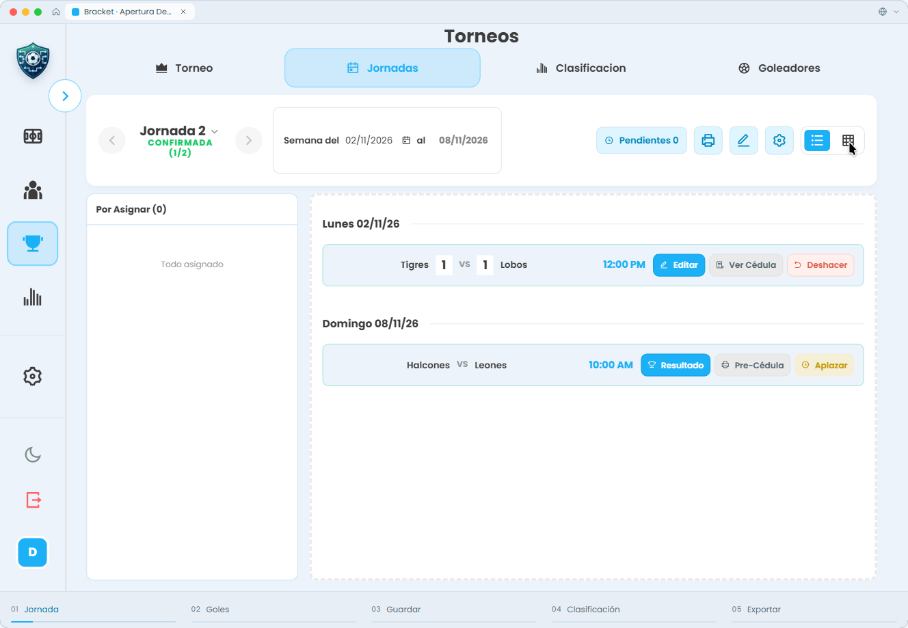
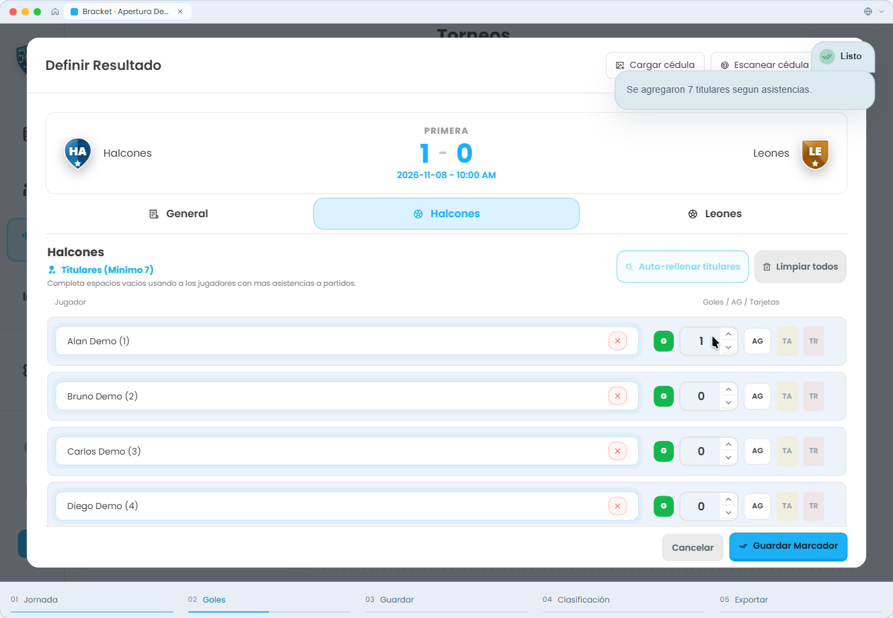
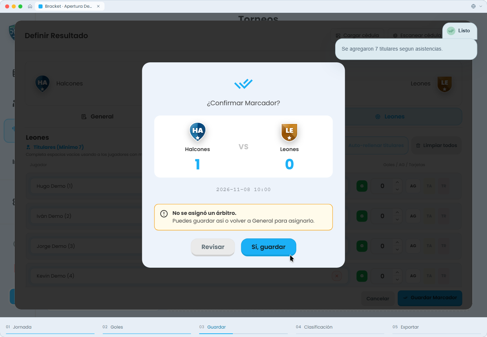
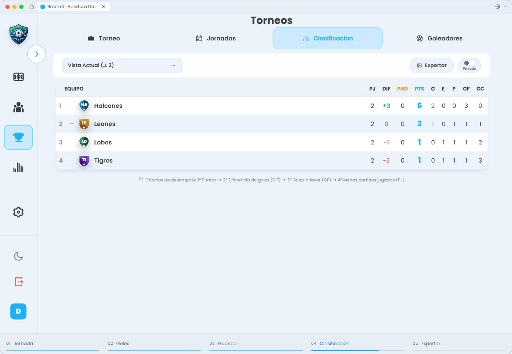
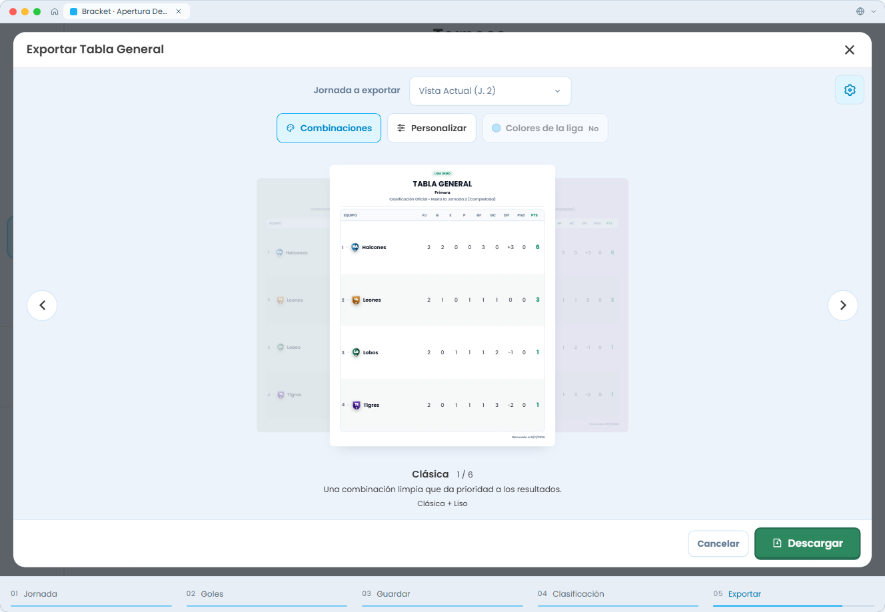

# Bracket · Demostración HTML

Una jornada de principio a fin: **5 pasos, 28 segundos**, con la interfaz clara de Bracket, su logo original, Poppins local y datos ficticios de un mismo torneo. Creada con la skill `html-demo` instalada en `C:\Users\Aldo\.agents\skills\html-demo`.

## Verla localmente

Desde la raíz del repositorio, con las dependencias del proyecto instaladas:

```powershell
npm run dev --prefix marketing/bracket-html-demo
```

Abre **http://127.0.0.1:5190**. No necesita cuenta, variables de entorno ni conexión a la base de datos. Si falta `node_modules`, instala primero las dependencias de la raíz con `npm ci`.

Para generar y servir la página estática, detén el servidor de desarrollo y ejecuta:

```powershell
npm run build --prefix marketing/bracket-html-demo
npm run preview --prefix marketing/bracket-html-demo
```

La exportación queda en `out/`. `preview` sólo necesita Node; sirve los archivos estáticos y no inicia la aplicación de producción. No abras `out/index.html` con `file://`: sus recursos usan rutas HTTP.

También se entrega `deliverables/bracket-demo-web.zip`, con la página ya compilada. Descomprímelo y ejecuta `node scripts/serve.mjs`; no necesita instalar dependencias. Las fuentes editables permanecen en esta carpeta del repositorio.

## Guion

| Paso | Intervalo | Acción y resultado | Permanencia final |
|---|---|---|---|
| Jornada | 0–6 s | Alternar lista/grilla, volver a la lista y abrir **Resultado**. Aparece **Definir Resultado** después de **Procesando datos...** | 1.3 s |
| Goles | 6–14 s | Abrir Halcones, **Auto-rellenar titulares**, escribir un gol para Alan Demo; abrir Leones y completar sus siete titulares. Marcador **1–0** | 1.8 s |
| Guardar | 14–19.5 s | **Guardar Marcador** → **¿Confirmar Marcador?** → **Sí, guardar**. La jornada muestra **1 VS 0**, **Editar** y **Ver Cédula** | 1.85 s |
| Clasificación | 19.5–24 s | Abrir **Clasificacion**. Tras el estado de carga, Halcones tiene **6 puntos**, Leones **3**, Lobos y Tigres **1** | 2.7 s |
| Exportar | 24–28 s | **Exportar** → **Cargando datos...** → **Exportar Tabla General**, con la combinación **Clásica + Liso** | 2.15 s |

El torneo es **Apertura Demo**, división **Primera**, de **Liga Demo**. Los equipos y jugadores son ficticios; los apellidos “Demo” lo hacen explícito. Los cuatro resultados coherentes están en `src/data.mjs`. La clasificación se calcula importando la función real `buildTorneoStandingsSnapshot` de Bracket; no es una tabla de puntos escrita a mano.

El flujo corresponde al **manager**. No representa permisos del público ni de un delegado. La última escena abre una vista previa de exportación; la demo no realiza una descarga ni publica en redes.

## Reproducción

- Autoplay al tener al menos 30 % de la ventana visible; pausa fuera de pantalla y cuando `document.hidden` es verdadero.
- Pausa/reanudación, bucle, cinco botones de capítulo, barra de progreso, scrubbing exacto, saltos de ±5 s y reinicio.
- `prefers-reduced-motion`: muestra el estado final completo de cada paso; los capítulos y el slider siguen funcionando. También responde si se cambia la preferencia con la página abierta.
- Escenario DOM de **1200 × 750**, escalado entero por el `ResizeObserver` oficial. La escena no redistribuye sus elementos en móvil.
- Controles reales accesibles; la interfaz simulada se anuncia como una imagen con descripción. El texto explicativo exterior permanece legible a 390 y 340 px.

## Código y mecanismo

| Archivo | Responsabilidad |
|---|---|
| `app/page.jsx`, `app/layout.jsx` | Página Next independiente y metadatos |
| `src/BracketDemo.jsx` | Página, precarga de logo/fuentes, controles y reloj externo |
| `src/scenes.jsx` | Cinco `View({ t })`, tiempos nombrados y coreografía |
| `src/ui.jsx`, `src/demo.css` | Reconstrucción DOM/CSS de las pantallas comprobadas |
| `src/TeamLogo.jsx` | Copia del `DynamicTeamLogo` original de Bracket |
| `src/data.mjs` | Fixture sintético y cálculo original de la clasificación |
| `src/aims.json` | Objetivos del cursor medidos en el DOM |
| `vendor/html-demo/` | `StepWindow`, `useStepClock`, `Cursor`, helpers, CSS y capturador oficiales |
| `scripts/measure.mjs` | Regenera los objetivos con medidas reales del escenario |
| `scripts/references.mjs` | Opera Bracket real con Auth, lecturas y RPC interceptados usando fixtures sintéticos |
| `scripts/verify.mjs` | Pruebas de interacción, determinismo, visibilidad, movimiento reducido y responsive |

Los estados, movimientos, spinners, escritura, notificaciones y resultados se derivan de `t`. Se usan explícitamente `ease`, `typed`, `cue`, `held` y `glide`. No hay temporizadores dentro de las escenas, estado acumulativo, videos, canvas ni WebGL.

Los objetivos se miden a 55 % del ancho y 60 % del alto de `[data-aim]`, divididos por la escala. Se verifican los doce clics contra las cajas de esos elementos. Tras cambiar tamaños o tipografía, vuelve a ejecutar:

```powershell
node marketing/bracket-html-demo/scripts/measure.mjs
```

El motor es la copia oficial, con correcciones locales documentadas: comprobación efectiva del umbral 0.3, preferencia de movimiento reactiva sin divergencia de hidratación, `seek` al estado final en modo reducido, reset del reloj al volver de visibilidad y soporte de eventos `freeze`/`resume`. Se oculta el DOM simulado a lectores de pantalla dentro del contenedor `role="img"`. El CSS de la página desactiva transiciones del cursor y entradas CSS para que los fotogramas congelados sean exactos.

## Evidencias y validación

```powershell
npm run verify --prefix marketing/bracket-html-demo
```

El servidor de la demo debe estar activo. El informe reproducible queda en `evidence/round-3/report.json`.

- `evidence/references/`: pantallas de **la aplicación real**, con fixtures sintéticos y guardado mediante RPC interceptado.
- `evidence/round-1/`: capturas cada segundo; correcciones de estructura, color, filas, marcadores y calendario.
- `evidence/round-2/`: capturas cada segundo; contraste con las referencias y corrección de visibilidad/ciclo de vida.
- `evidence/round-3/`: capturas cada 0.5 s de la entrega estática, estados principales, móviles, movimiento reducido e informe técnico.
- `RESEARCH.md`: funcionalidades comprobadas, decisiones de guion y referencias.
- `QA.md`: método y límites de las tres rondas.
- `evidence/source-manifest.json`: archivos originales, etiquetas comprobadas y hashes.

Capturas principales:







Para regenerar referencias, inicia **el build actual** de Bracket en `127.0.0.1:4182` con el mock de servidor que ya usa el proyecto, y ejecuta `scripts/references.mjs` con `BRACKET_REFERENCE_URL` apuntando a esa dirección. El script reutiliza `tests/e2e/fixtures/password-recovery-session.mjs`, intercepta las llamadas del navegador y lee la configuración local únicamente para generar la cookie sintética del entorno. Este procedimiento es independiente de ejecutar la demo, que no utiliza autenticación ni servicios.

## Alcance

Todo el código de esta entrega está aislado en esta carpeta. No se cambiaron rutas, autenticación, datos, permisos ni lógica de negocio de producción. No se invocaron OCR, proveedores de pago ni servicios de publicación. La duración de carga es una compresión ilustrativa; no es una promesa de rendimiento del servicio.

Poppins conserva su licencia SIL OFL en `public/fonts/OFL.txt`. El logo se copió sin recolorear. La fuente se declara en el sistema original y la demo carga los WOFF2 existentes para mantener métricas estables; algunas rutas originales no cargan esa fuente y pueden verse con el sans-serif de respaldo.
